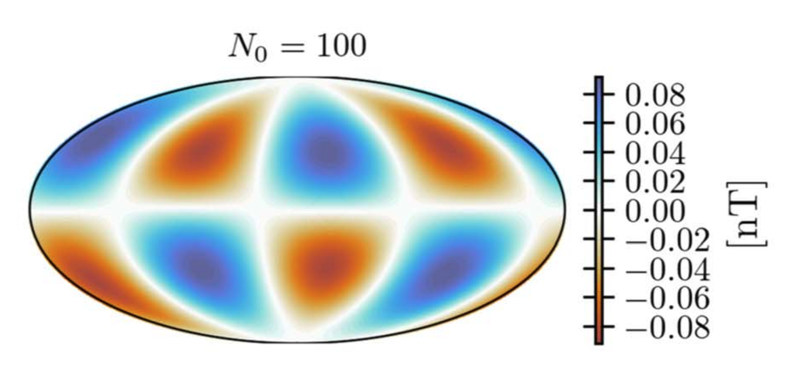

Many of the fluid dynamics phenomena that take place inside the Earth's core also manifest in the fluid layers of other astrophysical objects such as planets, moons, and stars. [Rossby modes](https://jrekier.github.io/bit-blog/posts/2022-02-13-rossby/) (a special type of inertial mode) have been observed in the convective envelope of the Sun [@LoptienEtAl2018], heralding a new era in Asteroseismology (the deep probing of stars through the study of their oscillations). More oscillations of this type were later observed [@HansonEtAl2022] and later confirmed as inertial modes by our team [@TrianaEtAl2022].

.")

Like Earth, Mercury has a conducting liquid core which is the host of internal oscillations, including inertial modes. In a study led by my colleague, F. Seuren, we showed that these modes can be excited by the small periodic variations of the planet's spin rate, known as *librations* [@SeurenEtAl2023]. These cause a differential rotation of Mercury's mantle at the top of the liquid core. In that study, we wanted to see if the excited modes could produce a torque at the core-mantle boundary that would make the two layers rotate not completely independently. Using our [numerical tools](/projects/NumericalMethods), we found that all torques were small, justifying the assumption used in previous work [@PealeEtAl2014]. 

In doing that, we also found something quite interesting. We found that if the top of Mercury's core is strongly buoyant (and thermal evolution models indicate it likely is), then the libration motion induces a magnetic field that can potentially be observable by the [ESA's *BepiColombo*](https://www.esa.int/Science_Exploration/Space_Science/BepiColombo) mission to Mercury. Measuring that magnetic field could thus offer an interesting window into the physical state of Mercury's deep core.

